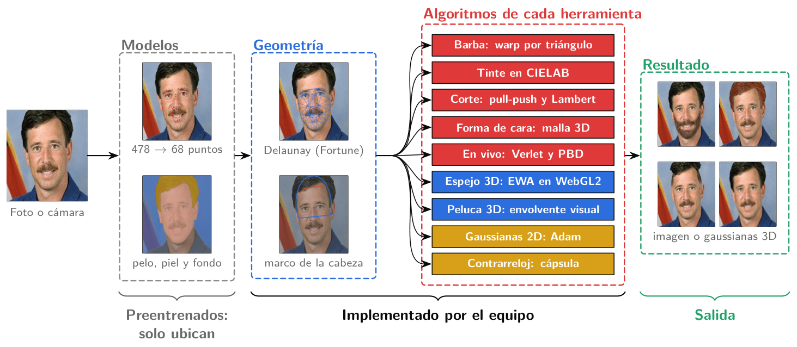
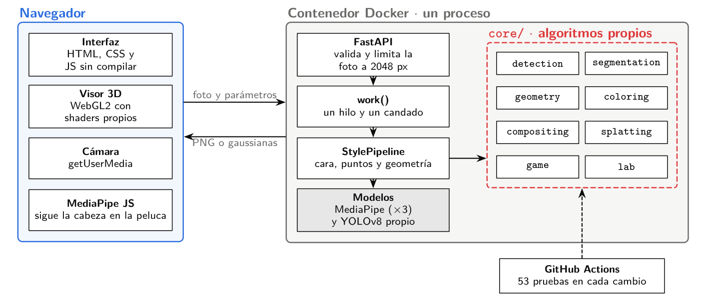
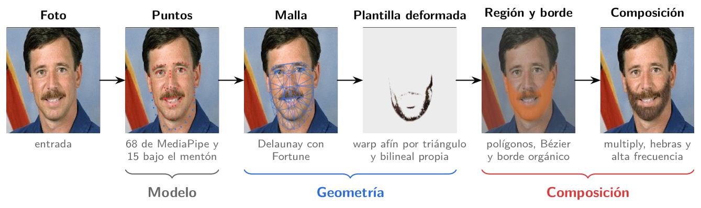
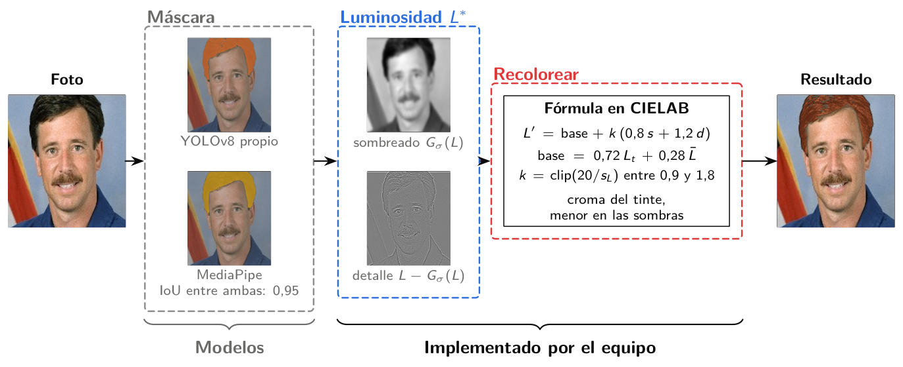
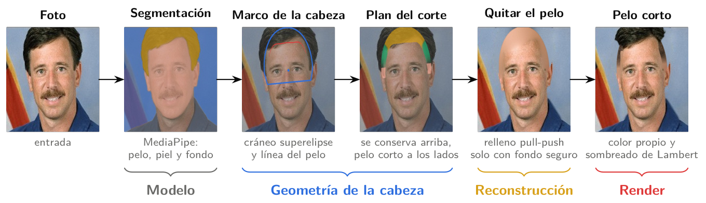
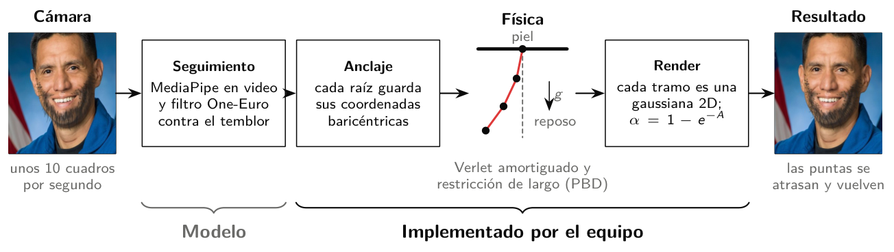
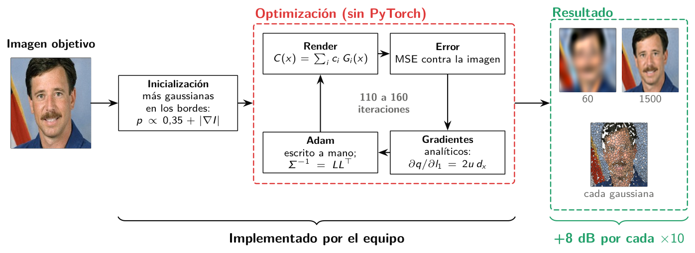
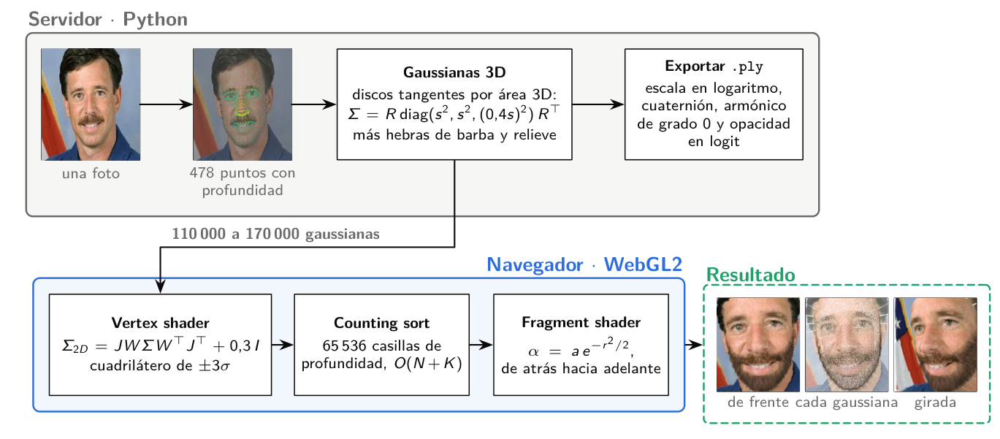
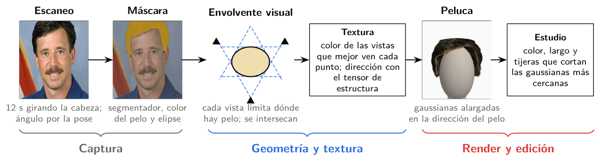
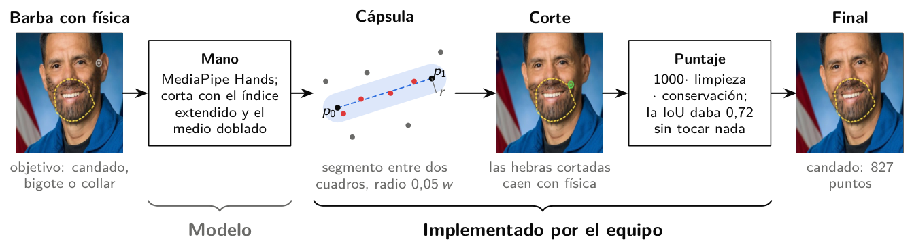

# Cómo funciona Fresh

Fresh no genera una cara nueva. Mide la geometría de la cara y del pelo de la persona y dibuja cada estilo sobre la foto original.

Los modelos preentrenados responden una sola pregunta: dónde están la cara, el pelo y la mano. Todo lo demás es código del equipo: la malla, el tinte, los cortes, la física, las gaussianas y el visor 3D. En el núcleo hay unas 4000 líneas de algoritmos gráficos propios y unas 600 que llaman a modelos.

Los diagramas usan las etapas reales del programa sobre un retrato de dominio público de la NASA. La explicación completa, con fórmulas y decisiones, está en el informe (`report/`), y un resumen de 4 páginas en formato de paper en `paper/main.pdf`. Para usar la aplicación paso a paso, ver la [guía de uso](guia-de-uso.md). La misma explicación está dentro de la app, en Inicio → Cómo funciona.

## Pipeline general



1. **Entrada.** Una foto subida, tomada con la cámara o la de ejemplo.
2. **Modelos.** MediaPipe da 478 puntos de la cara, que se convierten a los 68 puntos estándar, y un segmentador marca pelo, piel y fondo. El tinte puede usar en su lugar el YOLO que entrenó el equipo.
3. **Geometría.** Con los puntos se arma una malla de Delaunay (algoritmo de Fortune) y un marco de la cabeza medido en anchos de cabeza. Así un mismo parámetro vale para una foto de 600 px y para una de 4000 px.
4. **Herramientas.** Cada una aplica su propio algoritmo sobre esa geometría.
5. **Salida.** Una imagen compuesta o, en el 3D, una lista de gaussianas que dibuja el navegador.

## Arquitectura



- **Un solo proceso de FastAPI sirve la interfaz y la API.** Los endpoints solo validan la entrada y llaman al pipeline.
- **Cada llamada al pipeline pasa por `work()`.** Corre en un hilo aparte, detrás de un candado. El servidor sigue respondiendo mientras procesa una foto, y los modelos nunca se usan desde dos hilos a la vez.
- **Un solo proceso, a propósito.** El modo en vivo, la peluca y el juego guardan estado entre cuadros. Con dos procesos, ese estado se partía.
- **Cada técnica vive en su paquete de `backend/app/core/`.** Es lo que prueban los 54 tests de GitHub Actions.

## Qué se usa para cada cosa

| Parte | Técnica | Archivo | Origen |
|---|---|---|---|
| Puntos de la cara | MediaPipe Face Landmarker; 478 → 68 puntos por longitud de arco | `detection/landmarks.py` | Modelo |
| Pelo, piel y fondo | MediaPipe multiclase | `segmentation/mp_segmenter.py` | Modelo |
| Pelo (tinte) | YOLOv8n-seg con ajuste fino del equipo (mAP50 0,968) | `segmentation/yolo_segmenter.py`, `backend/training/` | Modelo entrenado por el equipo |
| Borde de la máscara | Filtro guiado | `segmentation/mask_refiner.py` | OpenCV |
| Punta del dedo | MediaPipe Hand Landmarker | `detection/hands.py` | Modelo |
| Malla | Delaunay con el barrido de Fortune | `geometry/delaunay_fortune.py` | Propio |
| Deformar plantillas | Afín por triángulo, baricéntricas, bilineal | `geometry/warp.py` | Propio |
| Barba | Multiply, hebras con Bézier, alta frecuencia | `compositing/beard.py` | Propio |
| Tinte | Luminosidad y color en CIELAB | `coloring/dye.py` | Propio |
| Tinte de barba | Textura y tensor de estructura | `segmentation/facial_hair.py` | Propio |
| Corte | Pull-push, cráneo superelipse, Lambert | `compositing/haircut.py` | Propio |
| Forma de cara | Medidas en la malla 3D y desviaciones z | `geometry/face_shape.py` | Propio |
| En vivo | Filtro One-Euro y anclaje baricéntrico | `detection/one_euro.py`, `compositing/beard.py` | Propio |
| Física de barba | Verlet y restricciones de distancia (PBD) | `compositing/beard_physics.py` | Propio |
| Gaussianas 2D | Gradientes analíticos y Adam escrito a mano | `splatting/gaussian_image.py` | Propio |
| Espejo 3D | Gaussianas 3D, proyección EWA, counting sort | `splatting/head3d.py`, `frontend/js/splat3d.js` | Propio |
| Peluca 3D | Envolvente visual por cortes, textura multivista | `splatting/hair3d.py`, `splatting/face3d.py`, `compositing/bald.py` | Propio |
| Laboratorio | Gaussianas en el marco local de cada triángulo | `lab/avatar.py` | Propio |
| Contrarreloj | Cápsula entre dos cuadros, puntaje | `game/speedrun.py` | Propio |

Las rutas de `backend/app/core/` se abrevian sin ese prefijo.

## Barba



- A los 68 puntos se suman 15 bajo la mandíbula, para que la barba bajo el mentón quede dentro de la malla.
- Una plantilla de barba real (CelebAMask-HQ) se deforma triángulo por triángulo hasta la cara: se resuelve la afín inversa, se prueba cada píxel con baricéntricas y se lee con interpolación bilineal.
- La barba se compone en tres capas. *Multiply* deja ver la luz de la piel, las hebras de Bézier dan volumen y la alta frecuencia de la plantilla aporta los pelos reales.
- Informe: sección 5.4.

## Tinte



- La máscara viene de YOLO o de MediaPipe. La app mide cuánto coinciden las dos (IoU).
- En CIELAB, la luminosidad se separa en sombreado (variación lenta) y detalle (mechones). La base se mueve hacia el tinte y el detalle se conserva, así un pelo negro puede quedar rubio.
- El croma baja en las sombras, como un pigmento real.
- Informe: sección 5.5.

## Corte



- El cráneo es una superelipse ajustada a la coronilla. La línea del pelo sale de la frente visible o, con flequillo, de una frente típica.
- El plan de cada corte dice qué pelo se conserva arriba y cuánto pelo corto crece a los lados.
- Donde se quita pelo, el fondo se rellena con pull-push usando solo píxeles de fondo seguro. Telea arrastraba pelo al fondo.
- El pelo corto toma el color propio y se sombrea con Lambert, con la luz estimada de la cara.
- Informe: sección 5.6.

## En vivo y física de la barba



- MediaPipe sigue la cara cuadro a cuadro y el filtro One-Euro le quita el temblor.
- Cada hebra son cuatro partículas. Su raíz está anclada a la piel con coordenadas baricéntricas.
- Verlet amortiguado mueve las partículas y una restricción de distancia (PBD) mantiene el largo, por eso la hebra se balancea como un péndulo.
- Cada tramo se dibuja como una gaussiana 2D y se acumula con 1 − e^(−A).
- Informe: sección 5.9.

## Gaussianas 2D



- Una imagen se reconstruye como suma de N gaussianas 2D. Cada una tiene centro, color y el factor de Cholesky de la inversa de su covarianza, para que siempre sea válida.
- El error se baja con gradientes analíticos y Adam escrito a mano, sin PyTorch.
- El PSNR sube unos 8 dB cada vez que se multiplica por 10 el número de gaussianas.
- Informe: sección 5.10.

## Espejo 3D



- En el servidor, la malla 3D de MediaPipe se cubre con discos gaussianos tangentes, repartidos por área 3D, más las hebras de la barba y un relieve para el resto de la foto.
- En el navegador, el *vertex shader* proyecta cada gaussiana con EWA. Un counting sort las ordena de atrás hacia adelante y el *fragment shader* las mezcla.
- La cabeza se exporta a `.ply`, el formato de 3D Gaussian Splatting.
- Informe: sección 5.11.

## Peluca 3D



- El escaneo guarda capturas con el ángulo de giro de la cabeza.
- La forma sale de la envolvente visual: en cada altura, cada vista limita dónde puede haber pelo, y la intersección da el corte de la peluca.
- El color sale de las vistas que mejor ven cada punto, y la dirección del pelo del tensor de estructura.
- En el estudio se cambia el color, el largo y se corta con tijeras.
- Informe: sección 5.12.

## Contrarreloj



- El dedo índice es la máquina de afeitar. Como a 10 cuadros por segundo salta mucho, se cortan las hebras cercanas al segmento entre dos cuadros (una cápsula).
- El puntaje es 1000 × limpieza × conservación.
- Informe: sección 5.14.

## Regenerar los diagramas

Los diagramas están escritos en TikZ en `report/diagramas/`. Las miniaturas salen del pipeline real (`miniaturas.py`). Las excepciones son las del espejo y la peluca, que son capturas del visor WebGL2 de la app, y las de la física y el juego, que salen de las figuras del informe.

```bash
cd backend && venv/bin/python ../report/diagramas/miniaturas.py
cd .. && python3 report/diagramas/build.py
```

`build.py` necesita `pdflatex` y `pymupdf` (`pip install pymupdf`). Deja un PDF para el informe y otro para las diapositivas, y un PNG en `docs/diagramas/`.
