# Cómo funciona Fresh

Fresh no genera una cara nueva. Mide la geometría de la cara y del pelo de la persona y dibuja cada estilo sobre la foto original.

Los modelos preentrenados responden una sola pregunta: dónde están la cara, el pelo y la mano. Todo lo demás es código del equipo: la malla, el tinte, los cortes, la física, las gaussianas, el visor 3D y las herramientas de Fiesta. En el núcleo hay unas 4000 líneas de algoritmos gráficos propios y unas 600 que llaman a modelos.

Los diagramas usan las etapas reales del programa sobre un retrato de dominio público de la NASA. La explicación completa, con fórmulas y decisiones, está en el informe (`report/`), y un resumen de 4 páginas en formato de paper en `paper/main.pdf`. Para usar la aplicación paso a paso, ver la [guía de uso](guia-de-uso.md). La misma explicación está dentro de la app, en Inicio → Cómo funciona.

## Pipeline general

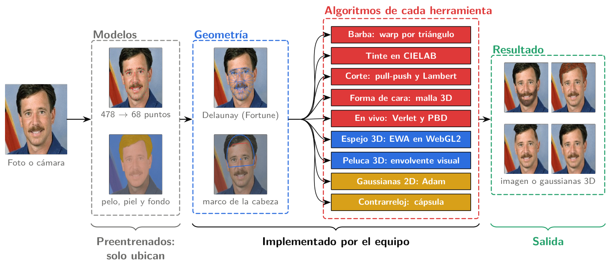

1. **Entrada.** Una foto subida, tomada con la cámara o la de ejemplo.
2. **Modelos.** MediaPipe da 478 puntos de la cara, que se convierten a los 68 puntos estándar, y un segmentador marca pelo, piel y fondo. El tinte puede usar en su lugar el YOLO que entrenó el equipo.
3. **Geometría.** Con los puntos se arma una malla de Delaunay (algoritmo de Fortune) y un marco de la cabeza medido en anchos de cabeza. Así un mismo parámetro vale para una foto de 600 px y para una de 4000 px.
4. **Herramientas.** Cada una aplica su propio algoritmo sobre esa geometría.
5. **Salida.** Una imagen compuesta o, en el 3D, una lista de gaussianas que dibuja el navegador.

## Arquitectura

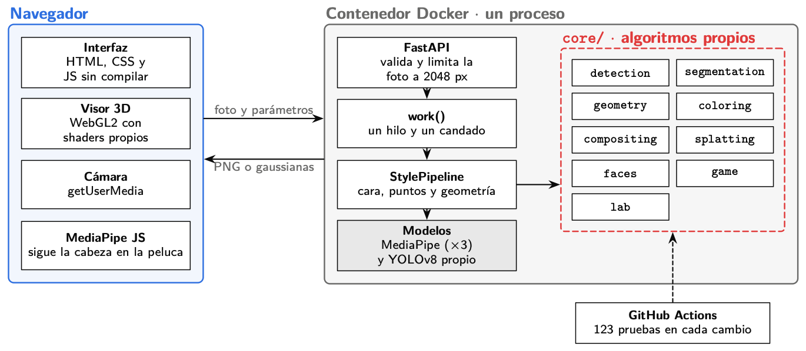

- **Un solo proceso de FastAPI sirve la interfaz y la API.** Los endpoints solo validan la entrada y llaman al pipeline.
- **Cada llamada al pipeline pasa por `work()`.** Corre en un hilo aparte, detrás de un candado. El servidor sigue respondiendo mientras procesa una foto, y los modelos nunca se usan desde dos hilos a la vez.
- **Un solo proceso, a propósito.** El modo en vivo, la peluca y el juego guardan estado entre cuadros. Con dos procesos, ese estado se partía.
- **Cada técnica vive en su paquete de `backend/app/core/`.** Es lo que prueban las 123 pruebas de GitHub Actions.

## Qué se usa para cada cosa

| Parte | Técnica | Archivo | Origen |
|---|---|---|---|
| Puntos de la cara | MediaPipe Face Landmarker; 478 → 68 puntos por longitud de arco | `detection/landmarks.py` | Modelo |
| Pelo, piel y fondo | MediaPipe multiclase | `segmentation/mp_segmenter.py` | Modelo |
| Pelo (tinte) | YOLOv8n-seg con ajuste fino del equipo (mAP50 0,968) | `segmentation/yolo_segmenter.py`, `backend/training/` | Modelo entrenado por el equipo |
| Matte del pelo (tinte) | Dos pasadas de filtro guiado sobre la máscara de YOLO | `segmentation/mask_refiner.py` | OpenCV |
| Punta del dedo | MediaPipe Hand Landmarker | `detection/hands.py` | Modelo |
| Malla | Delaunay con el barrido de Fortune | `geometry/delaunay_fortune.py` | Propio |
| Deformar plantillas | Afín por triángulo, baricéntricas, bilineal | `geometry/warp.py` | Propio |
| Barba | Multiply, hebras con Bézier, alta frecuencia | `compositing/beard.py` | Propio |
| Barba en vivo | Región como textura sobre la malla 3D, triángulos de frente pintados de atrás hacia adelante | `compositing/beard_mesh.py` | Propio |
| Tinte | Luminosidad en tres bandas y color en CIELAB | `coloring/dye.py` | Propio |
| Tinte de barba | Textura y tensor de estructura | `segmentation/facial_hair.py` | Propio |
| Corte | Pull-push, cráneo superelipse, Lambert | `compositing/haircut.py` | Propio |
| Forma de cara | Medidas en la malla 3D y desviaciones z | `geometry/face_shape.py` | Propio |
| En vivo | Filtro One-Euro y anclaje baricéntrico | `detection/one_euro.py`, `compositing/beard.py` | Propio |
| Física de barba | Verlet y restricciones de distancia (PBD) | `compositing/beard_physics.py` | Propio |
| Gaussianas 2D | Gradientes analíticos y Adam escrito a mano | `splatting/gaussian_image.py` | Propio |
| Espejo 3D | Gaussianas 3D, proyección EWA, counting sort | `splatting/head3d.py`, `frontend/js/splat3d.js` | Propio |
| Peluca 3D | Envolvente visual por cortes, textura multivista | `splatting/hair3d.py`, `splatting/face3d.py`, `compositing/bald.py` | Propio |
| Peluca en una vuelta | Giro de la cabeza sin cara: votos por punto seguido y mínimos cuadrados | `splatting/turntable.py` | Propio |
| Laboratorio | Gaussianas en el marco local de cada triángulo | `lab/avatar.py` | Propio |
| Contrarreloj | Cápsula entre dos cuadros, puntaje | `game/speedrun.py` | Propio |
| Puntos de varias caras | MediaPipe Face Landmarker, 468 puntos por cara, hasta 4 caras | `faces/mesh.py` | Modelo |
| Cara promedio | 400 caras frontales, Procrustes generalizado | `backend/training/mean_face.py` | Propio, con fotos de CelebAMask-HQ |
| Cambio de cara | Warp con mapeo inverso, Reinhard en Lab, mezcla multibanda | `faces/warp.py`, `faces/blend.py`, `faces/swap.py` | Propio |
| Caricatura | Brennan contra la cara promedio (Umeyama), escala local con smoothstep | `faces/caricature.py` | Propio |
| Fusión | Morphing: malla interpolada y mezcla cruzada | `faces/morph.py` | Propio |

Las rutas de `backend/app/core/` se abrevian sin ese prefijo.

## Barba

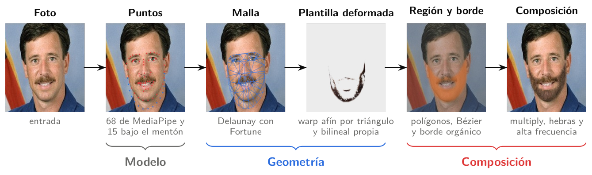

- A los 68 puntos se suman 15 bajo la mandíbula, para que la barba bajo el mentón quede dentro de la malla.
- Una plantilla de barba real (CelebAMask-HQ) se deforma triángulo por triángulo hasta la cara: se resuelve la afín inversa, se prueba cada píxel con baricéntricas y se lee con interpolación bilineal.
- La barba se compone en tres capas. *Multiply* deja ver la luz de la piel, las hebras de Bézier dan volumen y la alta frecuencia de la plantilla aporta los pelos reales.
- Informe: sección 5.4.

## Tinte

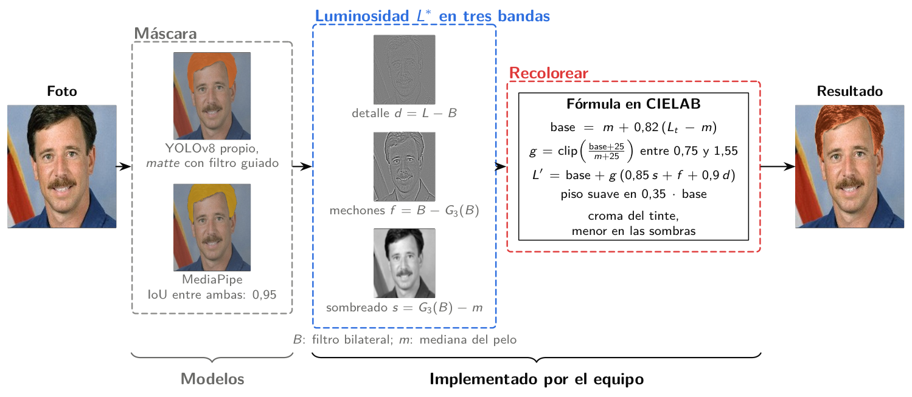

- La máscara viene de YOLO o de MediaPipe. La app mide cuánto coinciden las dos (IoU).
- Con YOLO, la máscara cruda pasa por dos filtros guiados con la foto como guía (radio = alto del pelo / 60, entre 3 y 16 px) y un smoothstep. Queda un matte suave, sin agujeros, con bordes que siguen al pelo.
- Antes la máscara se binarizaba, se le quitaban huecos por color y se difuminaba solo hacia adentro. Quedaban agujeros por donde asomaba el pelo original (los puntos negros) y el pelo claro sobre fondo oscuro se perdía.
- La luminosidad L del pelo se recorta al rango del propio pelo (percentiles 3 a 97), para que la piel bajo el borde suave no brille. Luego se separa en tres bandas:
  - detalle de los mechones: L menos un filtro bilateral;
  - mechones finos: el bilateral menos un gaussiano de σ 3;
  - sombreado amplio: el gaussiano menos la mediana del pelo.
- La base se mueve el 82 % hacia la L del tinte, así un pelo negro sí queda rubio. Las bandas se escalan por cuánto se aclara el pelo: ganancia = (base + 25) / (mediana + 25), entre 0,75 y 1,55.
- Lo muy oscuro se comprime suave bajo 0,35 × base. Así no aparecen puntos negros.
- El croma del tinte se multiplica por 0,55 + 0,45 × profundidad: baja en las sombras, como un pigmento real.
- Se probó en 8 caras con 7 colores: sin puntos negros y con el pelo cubierto completo en rubio y en pelo largo.
- Informe: sección 5.5.

## Corte

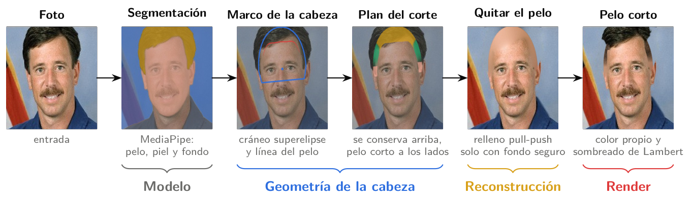

- El cráneo es una superelipse ajustada a la coronilla. La línea del pelo sale de la frente visible o, con flequillo, de una frente típica.
- El plan de cada corte dice qué pelo se conserva arriba y cuánto pelo corto crece a los lados.
- Donde se quita pelo, el fondo se rellena con pull-push usando solo píxeles de fondo seguro. Telea arrastraba pelo al fondo.
- El pelo corto toma el color propio y se sombrea con Lambert, con la luz estimada de la cara.
- Informe: sección 5.6.

## En vivo y física de la barba

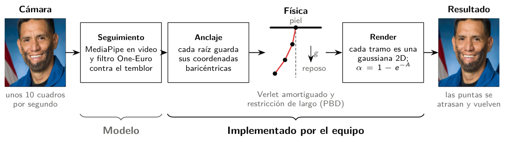

- MediaPipe sigue la cara cuadro a cuadro y el filtro One-Euro le quita el temblor.
- La barba en vivo es una textura sobre la malla 3D de la cara. Cada vértice recuerda dónde estaba en un cuadro de frente (su UV). En cada cuadro se descartan los triángulos que dan la espalda y el resto se pinta de atrás hacia adelante: lo que queda detrás de la nariz y de la mejilla se tapa. La región sigue a la cabeza en 3D en vez de salir de 68 puntos proyectados, que se juntan cuando la cara gira.
- Cada hebra son cuatro partículas. Su raíz está anclada a la piel con coordenadas baricéntricas.
- Verlet amortiguado mueve las partículas y una restricción de distancia (PBD) mantiene el largo, por eso la hebra se balancea como un péndulo.
- Cada tramo se dibuja como una gaussiana 2D y se acumula con 1 − e^(−A).
- Informe: sección 5.9.

## Gaussianas 2D

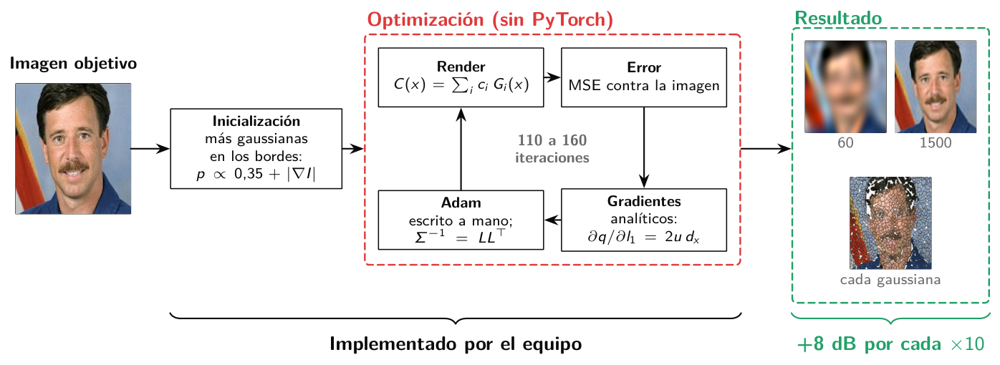

- Una imagen se reconstruye como suma de N gaussianas 2D. Cada una tiene centro, color y el factor de Cholesky de la inversa de su covarianza, para que siempre sea válida.
- El error se baja con gradientes analíticos y Adam escrito a mano, sin PyTorch.
- El PSNR sube unos 8 dB cada vez que se multiplica por 10 el número de gaussianas.
- Informe: sección 5.10.

## Espejo 3D

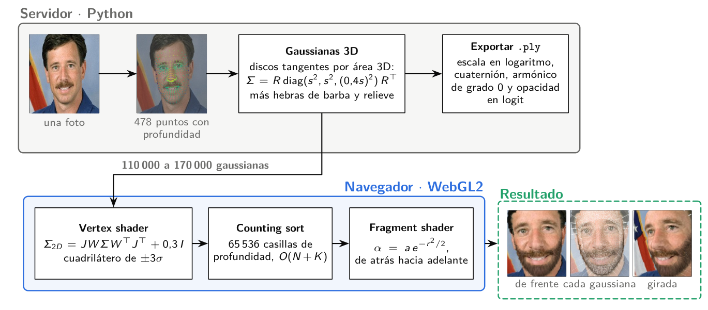

- En el servidor, la malla 3D de MediaPipe se cubre con discos gaussianos tangentes, repartidos por área 3D, más las hebras de la barba y un relieve para el resto de la foto.
- En el navegador, el *vertex shader* proyecta cada gaussiana con EWA. Un counting sort las ordena de atrás hacia adelante y el *fragment shader* las mezcla.
- La cabeza se exporta a `.ply`, el formato de 3D Gaussian Splatting.
- Informe: sección 5.11.

## Peluca 3D

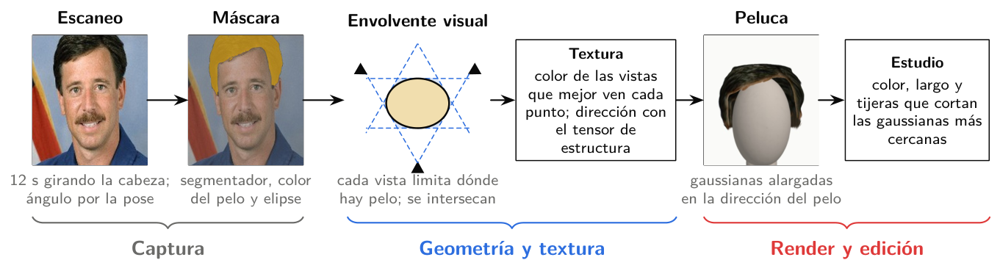

- El escaneo guarda capturas con el ángulo de giro de la cabeza.
- La forma sale de la envolvente visual: en cada altura, cada vista limita dónde puede haber pelo, y la intersección da el corte de la peluca.
- El color sale de las vistas que mejor ven cada punto, y la dirección del pelo del tensor de estructura.
- En el estudio se cambia el color, el largo y se corta con tijeras.
- También se puede escanear con una vuelta completa en una silla, o con un video de esa vuelta. De espaldas no hay cara, así que el giro sale de los puntos que se siguen entre cuadros: la cabeza se trata como una esfera y cada punto vota por un ángulo; se toma la mediana. Los cuadros con la cara a la vista fijan el ángulo real y un ajuste por mínimos cuadrados reparte el error del resto de la vuelta.
- Informe: sección 5.12.

## Contrarreloj

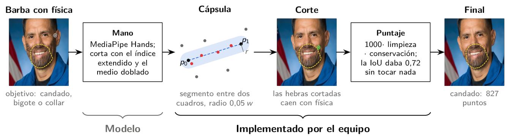

- El dedo índice es la máquina de afeitar. Como a 10 cuadros por segundo salta mucho, se cortan las hebras cercanas al segmento entre dos cuadros (una cápsula).
- El puntaje es 1000 × limpieza × conservación.
- Informe: sección 5.14.

## El practicante

Un pedido completo elegido al azar. **Primer día** elige entre todas las barbas, seis colores y los ocho cortes; **Ya aprendió** mide la forma de la cara en la malla 3D y elige solo entre lo sugerido para esa forma, con tonos naturales o sin tinte.

- `backend/app/core/compositing/look.py` aplica el pedido como un barbero: barba, tinte (que también tiñe la barba nueva) y corte. Un paso imposible, como teñir a un calvo, se salta y se informa en `X-Skipped`.
- `POST /api/look`; la interfaz en `frontend/js/practicante.js` reutiliza la ficha y Mis looks. Informe: sección 5.17.

## Galería

Tu cara dentro de siete retratos de dominio público (Lincoln, Marx, Twain, Douglass, Van Gogh, Einstein y Nietzsche), quedándote con su barba.

- **Retratos preparados una vez** (`backend/training/gallery.py`): busto 3:4 de 900 × 1200, malla de 468 puntos y zona de vello (regiones de barba de la app sobre los 68 puntos del retrato, agrandadas a ojo para cada barba). Créditos en `frontend/assets/galeria/CREDITOS.md`.
- **Composición** (`backend/app/core/faces/gallery.py`): el mismo cambio de cara de Fiesta con el retrato como destino. La máscara se multiplica por 1 − vello, así que la barba del retrato queda encima. En fotos antiguas la cara pasa a blanco y negro (Reinhard con la variación de color llevada a cero) y toma el grano de la foto; el contraste puede crecer hasta 2,5 veces para fotos de webcam oscuras.
- **Kuwahara** (`backend/app/core/faces/paint.py`): en el autorretrato de Van Gogh la cara se repinta con el filtro de Kuwahara (cuatro ventanas por píxel, gana la de menor varianza) calculado con imágenes integrales, más la pincelada del propio cuadro.
- Unos 1,5 s para los siete retratos. Informe: sección 5.16.

## Fiesta: cambio de cara, caricatura y fusión

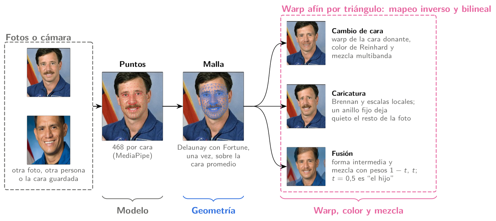

Las tres herramientas usan la misma maquinaria: la malla de 468 puntos de MediaPipe de cada cara (aquí sin pasar a los 68), una triangulación de Delaunay hecha con nuestro Fortune y un warp afín por triángulo con mapeo inverso. Ninguna inventa una cara: mueven píxeles de fotos reales.

- **Una sola triangulación.** Se calcula una vez sobre la cara promedio y se reutiliza para todas las caras y todos los cuadros. El triángulo número i es la misma parte de la cara en cualquier persona, y en vivo no hay que triangular en cada cuadro.
- **Cara promedio.** `backend/training/mean_face.py` corre MediaPipe sobre fotos de CelebAMask-HQ y se queda con 400 caras frontales. Cada malla se centra en el origen y se escala a radio RMS 1; después las mallas se alinean con Procrustes generalizado (4 iteraciones) y se promedian. Queda en `backend/app/assets/faces/mean_face.npy`.
- **Warp por mapeo inverso.** Cada triángulo del destino se rasteriza con su índice como color (`cv2.fillConvexPoly`, precisión de 1/16 px). Para todos los triángulos a la vez se resuelve un sistema de 3 × 3: la afín que lleva un píxel del destino a su lugar en la fuente. El color se lee con nuestra interpolación bilineal. Como se recorre el destino, no quedan huecos.
- **Robustez.** Si faltan caras (personas lejos de la cámara), se buscan otra vez en recortes cuadrados. Los triángulos que miran hacia atrás no se dibujan, y si la donante tiene la cabeza girada, la mejilla oculta se toma de la otra mejilla espejada. Banco de 40 casos difíciles en `docs/robustez/`.
- Informe: sección 5.15.

### Cambio de cara

- La cara donante se deforma triángulo por triángulo hasta la malla de la otra persona.
- El color se ajusta con la transferencia de Reinhard en Lab: media y desviación de cada canal dentro de la cara (razón de desviaciones entre 0,6 y 1,6).
- Después se copia la luz amplia de la persona: se multiplica L por la razón de las dos luminosidades desenfocadas (σ = ancho de cara / 10, razón entre 0,7 y 1,4). Una cara iluminada desde la izquierda sigue iluminada desde la izquierda.
- La cara se pega con una mezcla multibanda (Burt y Adelson): pirámides laplacianas de las dos imágenes y pirámide gaussiana de la máscara, hasta 5 niveles. El color amplio se mezcla en una franja ancha y el detalle fino en una angosta: no queda costura ni doble contorno.
- La máscara es el óvalo de la cara, encogido 4 % del ancho y difuminado 5 %. La línea del pelo y el borde de la mandíbula siguen siendo los de la foto.
- **Entre ustedes:** cada cara recibe la de la persona a su derecha; con dos personas es un intercambio. **Una cara para todos:** todos llevan la cara guardada.
- Archivos: `faces/swap.py`, `faces/warp.py`, `faces/blend.py`.

### Caricatura

- **Caricatura** usa la fórmula de Brennan: P' = A + (1 + k)(P − A). A es la cara promedio ajustada a esta cara con la similitud de Umeyama (escala, rotación y traslación por mínimos cuadrados), y k = 2 × intensidad. Crece justo lo que hace distinta a la cara.
- Los otros cinco efectos escalan un rasgo alrededor de su centro, con caída smoothstep: factor completo en el centro y nada en el borde del radio. Ojotes agranda los ojos, Narizón la nariz, Cachetón toda la cara, Carita la achica, y Alien agranda los ojos y achica la boca, el mentón y la nariz.
- Un anillo de 28 puntos fijos alrededor de la cabeza (a 1,9 veces la semiextensión del óvalo) entra en la malla. Lo de afuera no se mueve y los triángulos entre la cara y el anillo estiran la piel y el fondo sin cortes.
- Archivos: `faces/caricature.py`, `faces/mesh.py`.

### Fusión

- Morphing clásico. Cada cara se recorta a un cuadrado de 480 px y la segunda se alinea a la primera con una similitud.
- Cada malla tiene los 468 puntos, un anillo de 20 puntos a 1,5 veces el óvalo y 16 puntos en el borde del cuadro. Se triangula con Fortune sobre la forma promedio de las dos.
- Para 13 valores de t entre 0 y 1, las dos fotos se deforman a la forma (1 − t)A + tB y después se mezclan con pesos 1 − t y t. Deformar antes de mezclar hace que los ojos y la boca de las dos caras caigan en el mismo lugar: sin eso sale una doble exposición.
- t = 0,5 es «el hijo» de los dos. Con los dos nombres, la app arma el del hijo: la primera mitad del primero y la segunda mitad del segundo (Kalos + Gianpier → Kalpier).
- Archivo: `faces/morph.py`.

### Tiempos

Medidos en una Mac con chip M, en CPU:

| Operación | Tiempo |
|---|---|
| Detección, cuadro de 640 × 360 con dos caras | 12 ms |
| Cambio de cara en vivo, por cuadro | 44 ms |
| Caricatura en vivo, por cuadro | 49 ms |
| En vivo, en el servidor | unos 15 cuadros por segundo |
| Cambio de dos caras en una foto | 0,1 a 0,4 s, según el tamaño |
| Caricatura en una foto | 0,05 a 0,15 s |
| Fusión de 13 cuadros | ~1,5 s |

La fusión es lo más lento: cada cuadro deforma dos imágenes completas de 480 × 480, así que son 26 warps.

## Regenerar los diagramas

Los diagramas están escritos en TikZ en `report/diagramas/`. Las miniaturas salen del pipeline real (`miniaturas.py`). Las excepciones son las del espejo y la peluca, que son capturas del visor WebGL2 de la app, y las de la física y el juego, que salen de las figuras del informe.

```bash
cd backend && venv/bin/python ../report/diagramas/miniaturas.py
cd .. && python3 report/diagramas/build.py
```

`build.py` necesita `pdflatex` y `pymupdf` (`pip install pymupdf`). Deja un PDF para el informe y otro para las diapositivas, y un PNG en `docs/diagramas/`.
