# Guía de uso

Cómo usar cada pantalla de Fresh. Para saber qué hace por dentro cada herramienta, ver [cómo funciona](como-funciona.md).

## Antes de empezar

1. Levantar la aplicación desde la raíz del repositorio. La primera vez tarda unos minutos.

   ```bash
   docker compose up -d --build app
   ```

2. Abrir http://localhost:8000 en Chrome.
3. Para las pantallas con cámara, aceptar el permiso del navegador.

Los resultados salen mejor con una foto de frente, con luz pareja, fondo liso y sin gorra.

## Inicio

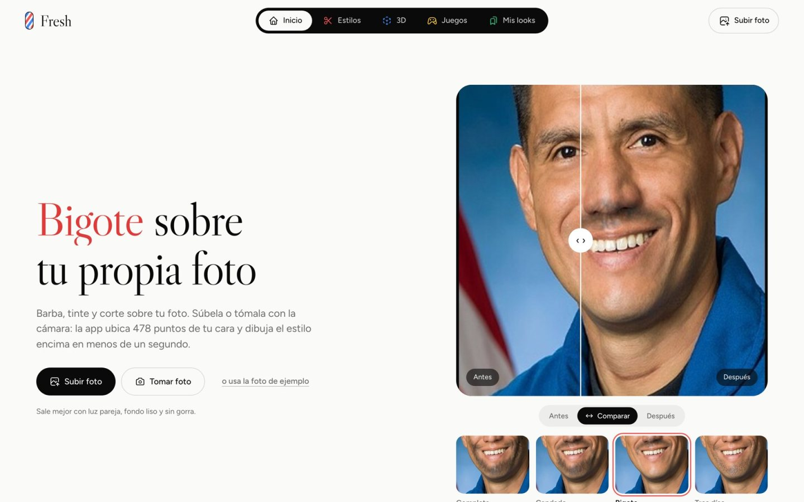

- **Subir foto**, **Tomar foto** o **usa la foto de ejemplo**. La foto queda cargada en todas las herramientas, así que se sube una sola vez.
- Arriba se elige el grupo: **Estilos**, **3D**, **Juegos** o **Mis looks**. En el celular esa barra queda abajo.
- La lista de herramientas indica si cada una usa una foto o la cámara.

## Barba

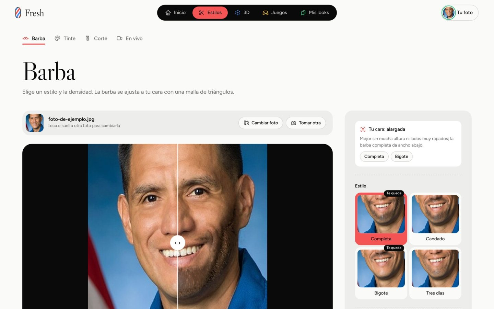

1. Elegir **Completa**, **Candado**, **Bigote** o **Tres días**. Los estilos que van con la forma de la cara llevan la marca «Te queda».
2. Ajustar la **Densidad** y tocar **Aplicar barba**.
3. Mover el divisor del comparador, o usar **Antes**, **Comparar** y **Después**.
4. **Mostrar la malla de triángulos** dibuja la malla de Delaunay sobre la cara.

## Tinte

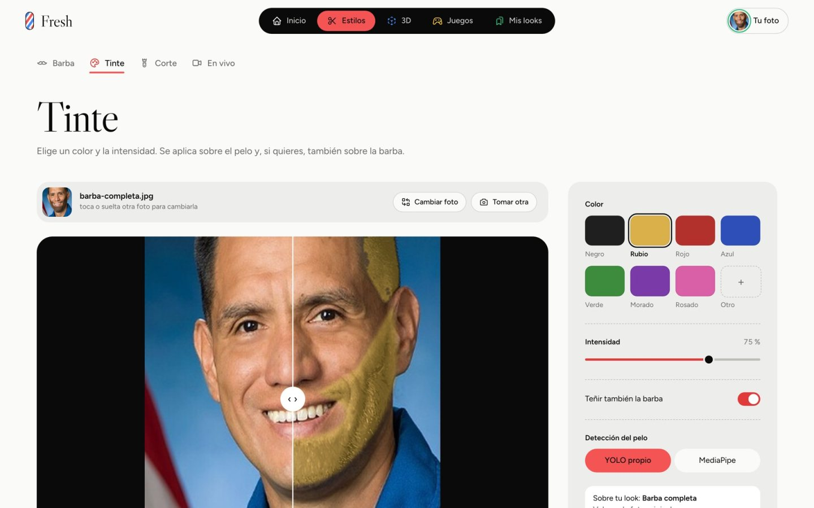

1. Elegir uno de los siete colores u **Otro** para uno libre, y la **Intensidad**.
2. Opcional: **Teñir también la barba**.
3. Opcional: elegir el segmentador, **YOLO propio** o **MediaPipe**. La nota bajo el resultado dice cuánto coinciden los dos.
4. Tocar **Aplicar tinte**.

## Corte

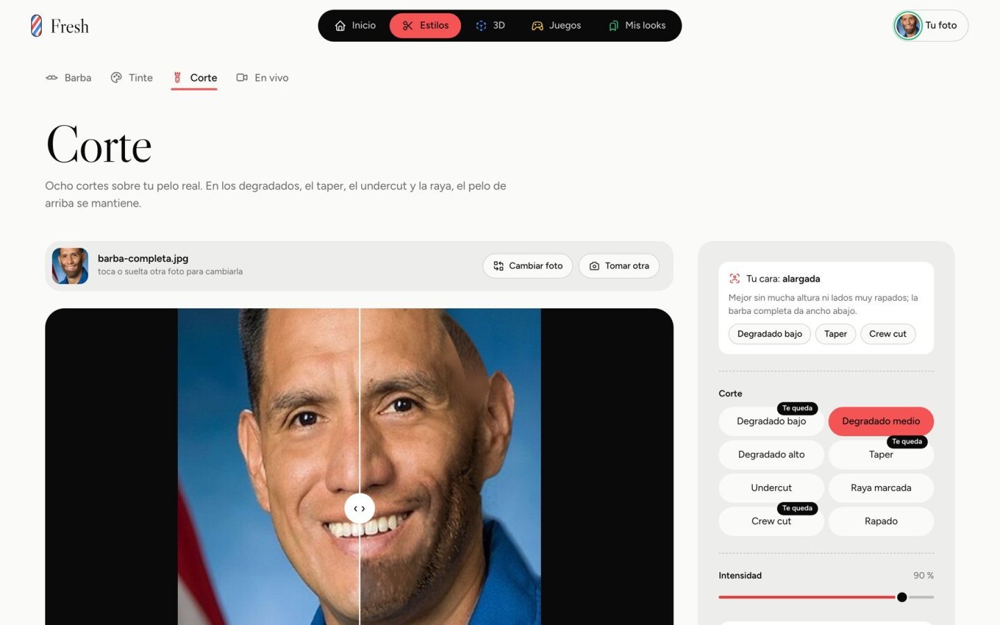

1. Elegir uno de los ocho cortes: degradado bajo, medio o alto, taper, undercut, raya marcada, crew cut o rapado.
2. La **Intensidad** dice qué tan corto: más intensidad deja ver más cuero cabelludo.
3. Tocar **Aplicar corte**.

## Combinar y llevarlo a la barbería

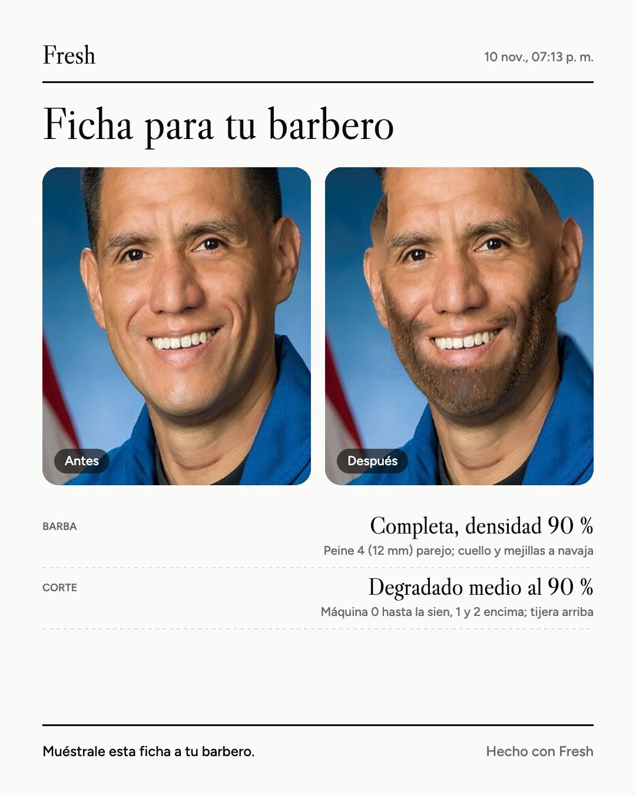

- Bajo cada resultado, **Agregar tinte**, **Agregar corte** o **Agregar barba** aplica otra herramienta sobre ese resultado. **Volver a la foto original** empieza de nuevo.
- **Guardar** lo deja en Mis looks.
- **Descargar** baja la imagen.
- **Ficha para tu barbero** baja una tarjeta con cada servicio: el número de máquina, dónde va cada número y el código del color.

## En vivo

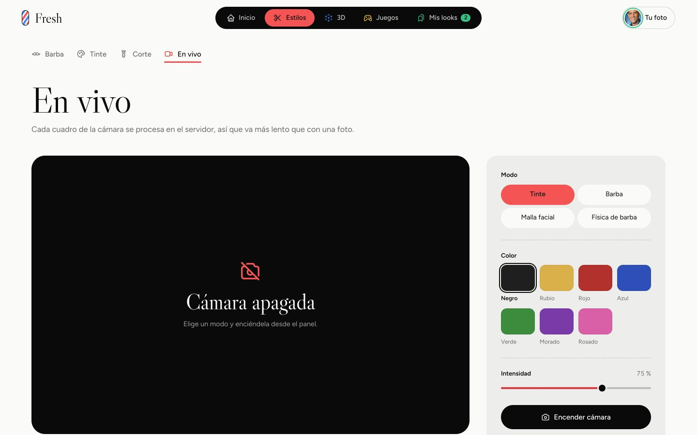

1. Elegir el modo: **Tinte**, **Barba**, **Malla facial** o **Física de barba**.
2. Tocar **Encender cámara**.
3. En **Física de barba**, el **Largo de la barba** cambia el largo de las hebras. Al girar la cabeza rápido, las puntas se atrasan.

Cada cuadro se procesa en el servidor, a unos 10 cuadros por segundo.

## Espejo 3D

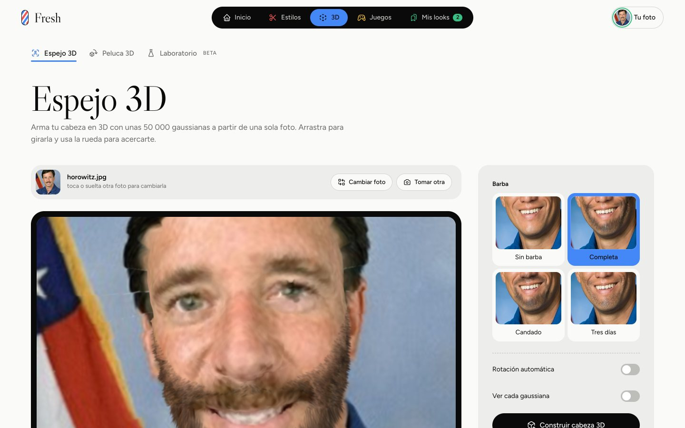

1. Con la foto cargada, elegir la barba (o **Sin barba**) y tocar **Construir cabeza 3D**.
2. Arrastrar para girar y usar la rueda para acercarse. **Reiniciar vista** la centra.
3. **Ver cada gaussiana** achica cada gaussiana para ver la técnica.
4. **Descargar .ply** baja la cabeza en el formato de 3D Gaussian Splatting.

## Peluca 3D

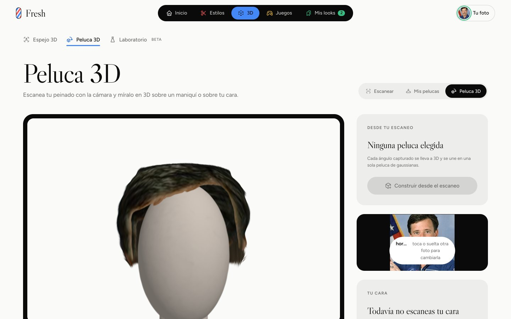

1. En **Escanear**, tocar **Encender cámara** y luego **Empezar escaneo**. Empezar mirando a la izquierda y girar despacio hacia la derecha durante 12 segundos.
2. En **Mis pelucas**, elegir el escaneo y construir la peluca 3D. También se puede construir desde una foto.
3. En la vista 3D:
   - cambiar el color y la intensidad;
   - recortar con **Largo**, **Cortar puntas** o **Rapar**;
   - activar las **Tijeras** y pintar sobre la peluca para cortar esa parte (Shift y arrastrar para girar mientras se corta);
   - **Deshacer** o **Restaurar pelo**.

## Laboratorio

Está en prueba. Se escanea la cabeza de frente, a 3/4 y de perfil (**Escanear (7 s)**), o se suben fotos, y se toca **Construir cabeza**. El **Avatar en vivo** sigue la cara con la cámara.

## Contrarreloj

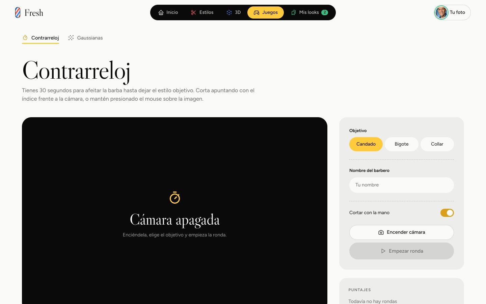

1. Elegir el objetivo: **Candado**, **Bigote** o **Collar**. Opcional: escribir el **Nombre del barbero** para la tabla de puntajes.
2. Tocar **Encender cámara** y **Empezar ronda**.
3. Afeitar en 30 segundos con el índice extendido y el dedo medio doblado. Si se desactiva **Cortar con la mano**, se corta manteniendo presionado el mouse.

Puntaje = afeitado × objetivo intacto × 1000.

## Gaussianas

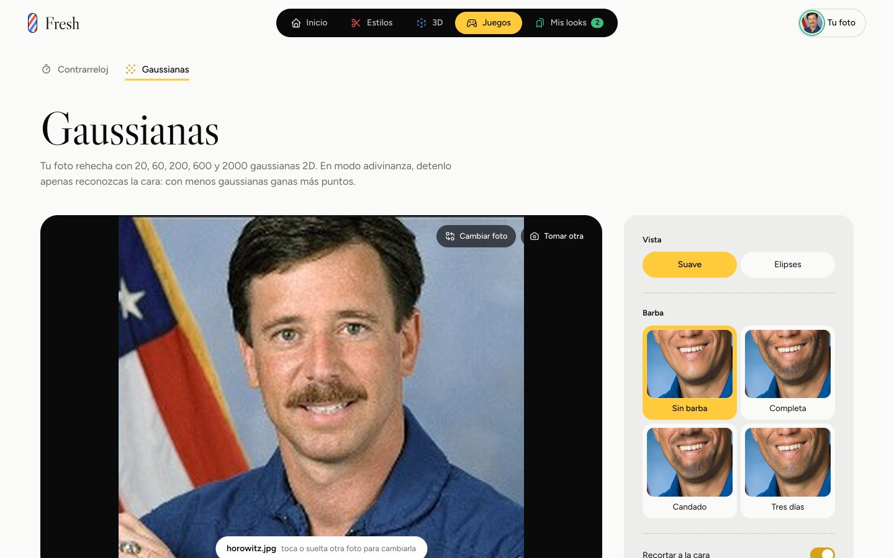

1. Con la foto cargada, elegir la vista (**Suave** o **Elipses**) y, opcionalmente, una barba.
2. Tocar **Empezar**. La foto se rehace con 20, 60, 200, 600 y 2000 gaussianas.
3. En **Modo adivinanza**, tocar **La reconozco** apenas se reconozca la cara: con menos gaussianas, más puntos.

## Mis looks

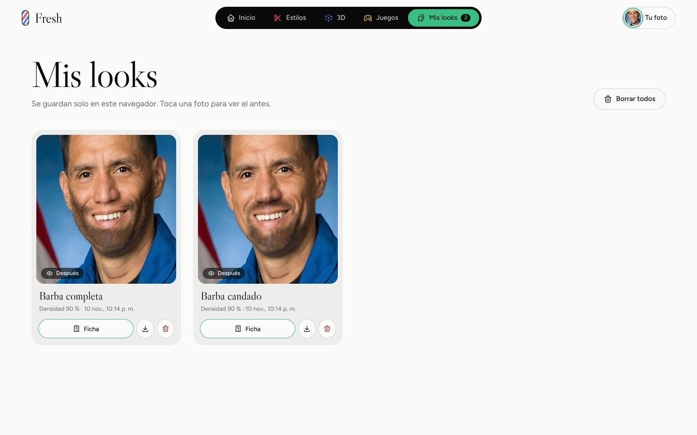

- Muestra los looks guardados, solo en este navegador.
- Tocar una foto alterna entre el antes y el después.
- Cada tarjeta tiene **Ficha**, un botón para descargar la imagen y otro para borrar el look. **Borrar todos** vacía la lista.

## Si algo falla

| Mensaje o síntoma | Qué hacer |
|---|---|
| No se detectó la cara | Usar una foto de frente, con la cara completa y buena luz. |
| No se detectó pelo | El tinte y el corte necesitan pelo visible; con la cabeza rapada no hay nada que teñir ni cortar. |
| La cámara no enciende | Aceptar el permiso del navegador y cerrar otras apps que usen la cámara. |
| La primera vez tarda | Los modelos se cargan al primer uso; las siguientes fotos tardan de 0,1 a 2,5 s. |
| Sin internet, la prueba en vivo de la peluca no sigue la cabeza | Esa parte carga MediaPipe para JavaScript desde internet; el resto funciona sin conexión. |
